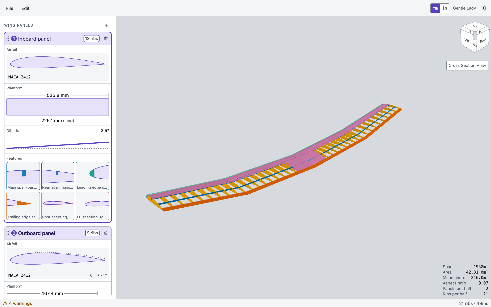
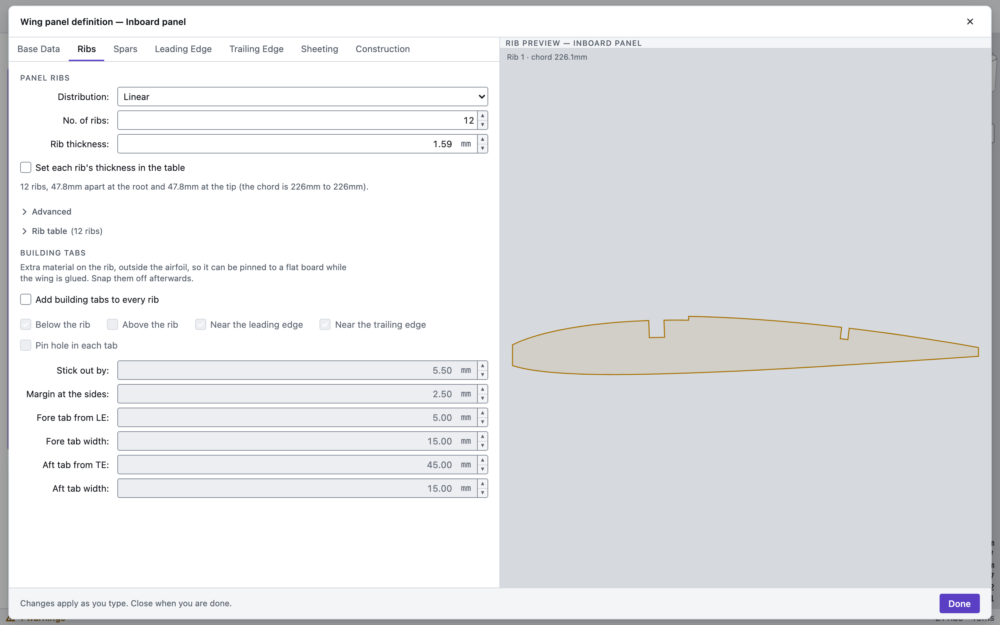
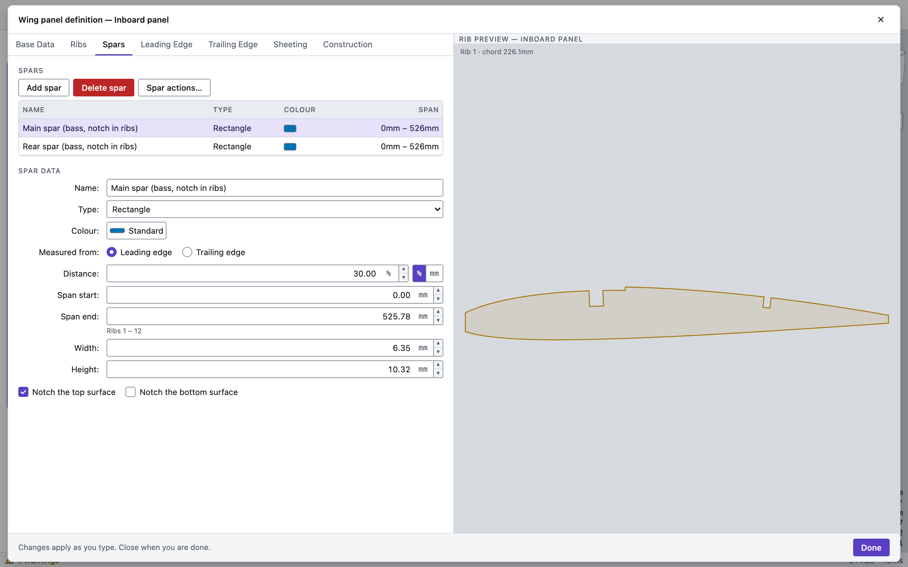
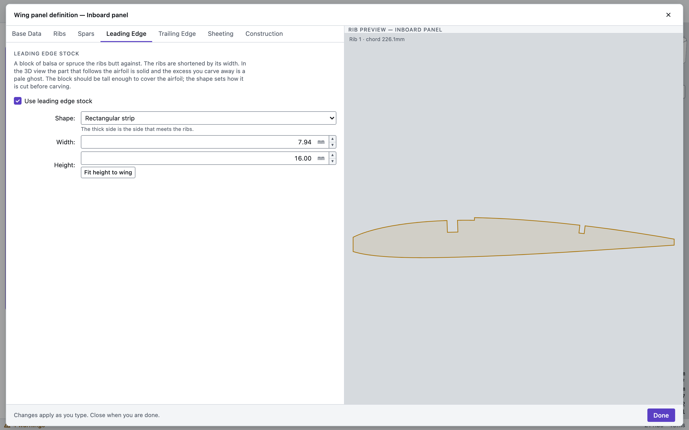
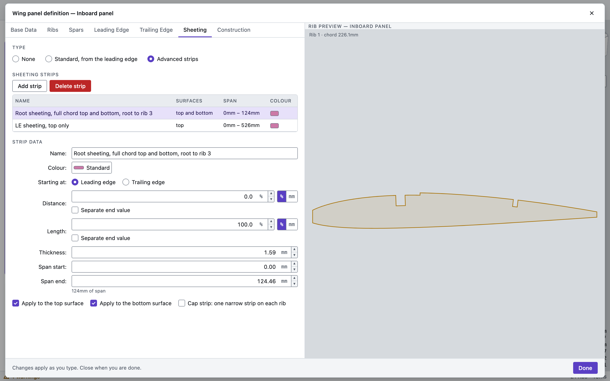
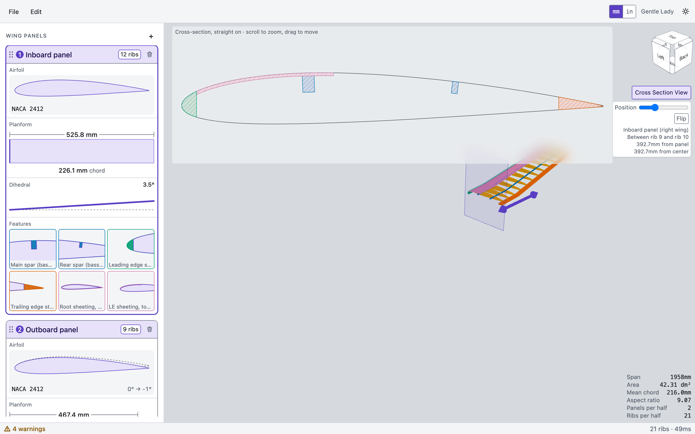
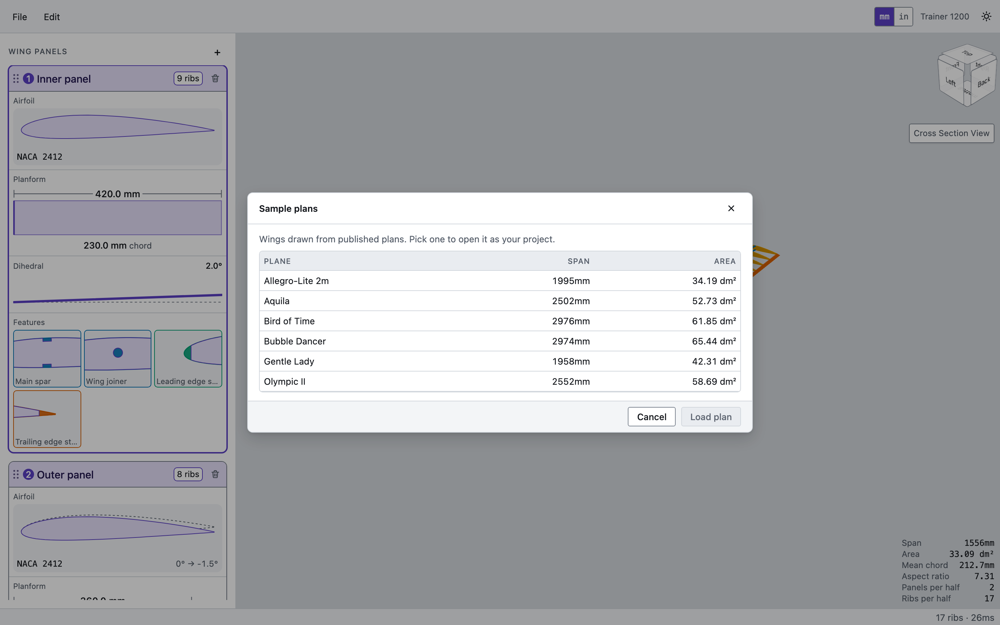
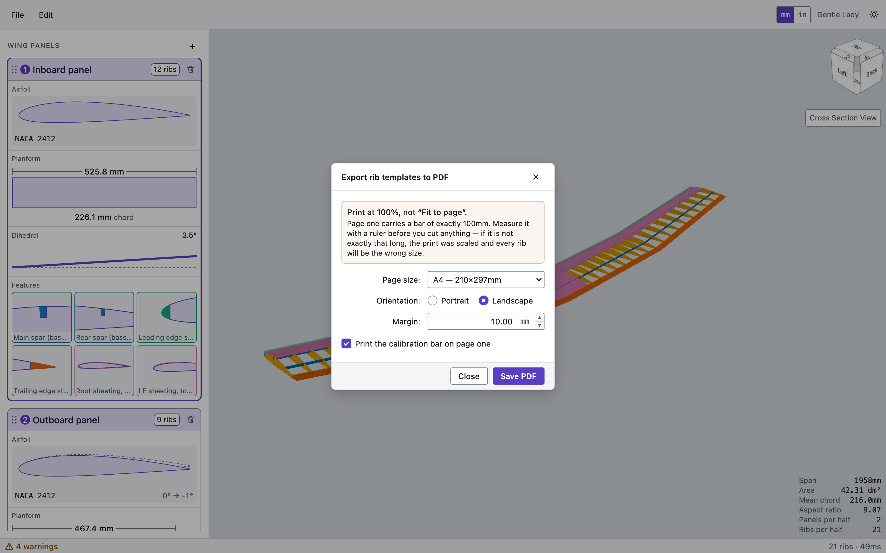
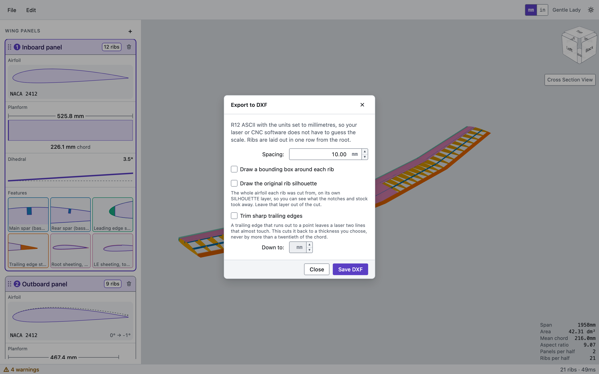

# Wing Buddy

Design an RC model aircraft wing in your browser, watch it build in 3D, and export 1:1 rib templates (PDF) and cutting files (DXF). Free, no account, nothing to install, and your designs never leave your computer.

**[Open Wing Buddy](https://jasonhamiton.github.io/wing-buddy/)** · **[Download a build](https://github.com/jasonhamiton/wing-buddy/releases/latest)** · [Landing page](https://jasonhamiton.github.io/wing-buddy/landing.html)



## What it does

Define a wing panel by panel. Every change rebuilds the 3D model and the ribs immediately, and the status bar warns you when a geometry choice does not work.

- **Panels**: root and tip chord, span, sweep, dihedral, and twist. Add as many panels per half wing as you need and reorder them by dragging.
- **Airfoils**: NACA 4-digit generator, import of Selig `.dat` airfoil files, thickness scaling, and a different section at each end of a panel.
- **Ribs**: linear, exponential, chord-proportional and custom distributions, per-rib thickness and position table, half ribs with front and rear cut lines, and building tabs so ribs pin flat to a board.
- **Spars and joiners**: rectangular spars notched into the top and/or bottom surface, round and rectangular joiners, measured from either edge by percentage or length.
- **Edges**: leading and trailing edge stock, with shaped or block profiles.
- **Sheeting**: standard or advanced strips on top, bottom or both, with root-to-rib or full-span runs and cap strips.
- **Combs and lightening holes**: for ribs that need to stay light and stay square.
- **Ailerons**: cut from the panel with their own rib treatment.
- **Cross-section view**: slice the wing anywhere and see exactly what a rib looks like at that spot.
- **Sample plans**: six ready-made wings to open and explore.
- **Everything else**: undo and redo, millimetres or inches, light and dark themes, project files you can save and reopen.

## Screenshots

### Panel definition

Each panel opens into a dialog with a live rib preview. Ribs, spars, edges, sheeting and construction details each have their own tab.

| Ribs | Spars |
| --- | --- |
|  |  |

| Leading edge | Sheeting |
| --- | --- |
|  |  |

### Cross-section view



### Sample plans



### Exports

| PDF rib templates | DXF for laser or CNC |
| --- | --- |
|  |  |

- **PDF**: 1:1 rib templates on the paper size you choose, with a calibration bar on page one so you can check your printer's scale before cutting.
- **DXF**: R12 ASCII in millimetres, ribs laid out in a row, optional bounding boxes, silhouette layer and trailing-edge trim.
- **OpenSCAD**: export the wing as a model for further work.
- **Project file**: save and reopen your design as JSON.

## Run it

Use the hosted version at **https://jasonhamiton.github.io/wing-buddy/**, or download the latest build from the [Releases page](https://github.com/jasonhamiton/wing-buddy/releases/latest), unzip it and serve the folder with any static web server (for example `npx serve`).

To work on the code:

```sh
npm install
npm run dev        # http://localhost:3000
npm test           # unit tests (vitest)
npm run test:e2e   # browser tests (playwright)
npm run build      # production build in dist/
```

Pushes to `main` deploy to GitHub Pages through `.github/workflows/pages.yml`. Pushing a tag such as `v0.1.0` builds a zip and attaches it to a release through `.github/workflows/release.yml`. To enable Pages, set **Settings → Pages → Source** to **GitHub Actions**.

To regenerate the screenshots, start `npx vite preview --port 4317` after a build and run `node scripts/screenshots.mjs`.

## Built with

React, TypeScript, Vite, Tailwind CSS, three.js for the 3D view, Clipper2 for 2D geometry, and pdf-lib for PDF output. The geometry runs in a web worker.

## Licence

[MIT](LICENSE)
